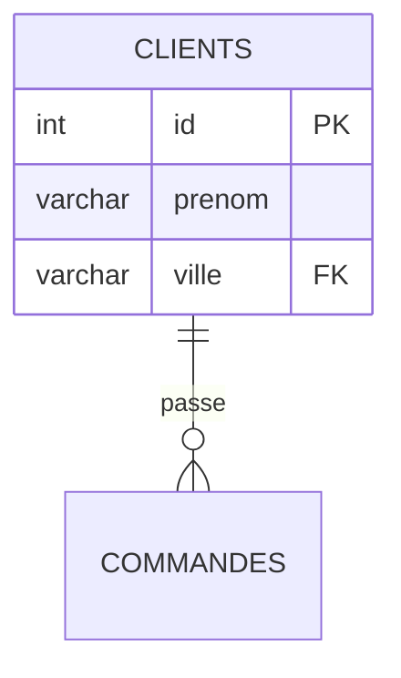
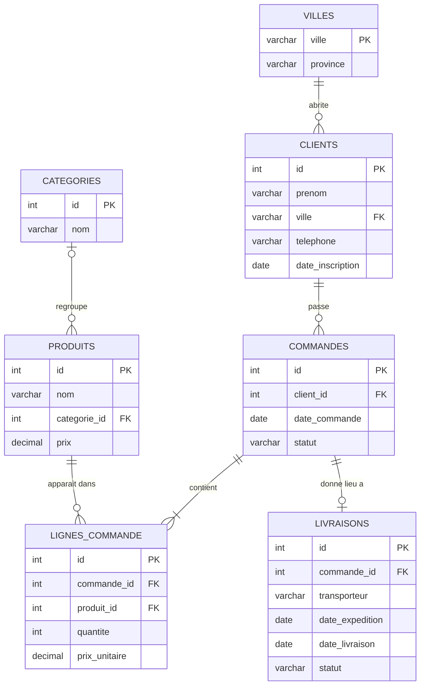
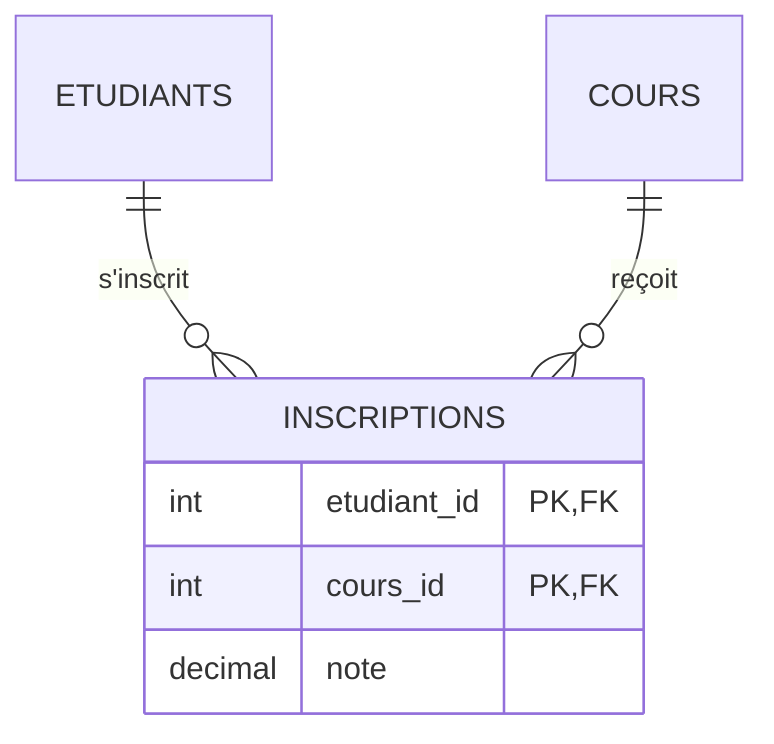

# Aide-mémoire : diagrammes entité-association et cardinalités

## 1. Vocabulaire

| Terme | Dans la base de données |
|-------|-------------------------|
| Entité | Une table (clients, commandes...) |
| Attribut | Une colonne |
| Identifiant | La clé primaire |
| Association | Une relation entre deux tables, portée par une clé étrangère |
| Cardinalité | Combien d'éléments d'un côté correspondent à un élément de l'autre côté |

## 2. La cardinalité : deux chiffres par côté

Chaque côté d'une relation a un **minimum** (0 ou 1) et un **maximum** (1 ou plusieurs).

| Notation | Se lit | Minimum, maximum |
|----------|--------|------------------|
| `\|\|` | exactement un | 1, 1 |
| `o\|` ou `\|o` | zéro ou un | 0, 1 |
| `\|{` ou `}\|` | un ou plusieurs | 1, n |
| `o{` ou `}o` | zéro ou plusieurs | 0, n |

**Règle de lecture (Mermaid) :** le symbole écrit à côté d'une entité dit **combien de cette entité** correspondent à **un seul élément de l'autre entité**.

```
CLIENTS ||--o{ COMMANDES : "passe"
```
- Symbole côté COMMANDES (`o{`) : **un** client passe **zéro ou plusieurs** commandes.
- Symbole côté CLIENTS (`||`) : **une** commande est passée par **exactement un** client.

**Méthode :** pose toujours **deux questions**, une dans chaque sens, avec « au minimum » et « au maximum ».

## 3. De la cardinalité à SQL

| Ce que dit le diagramme | Ce qu'on écrit en SQL |
|-------------------------|-----------------------|
| Relation un-à-plusieurs (1,n ou 0,n) | Une **clé étrangère** dans la table du côté « plusieurs » |
| Minimum 1 du côté de la clé étrangère | La clé étrangère est **`NOT NULL`** |
| Minimum 0 du côté de la clé étrangère | La clé étrangère **accepte `NULL`** |
| Maximum 1 des deux côtés (relation 0,1 ou 1,1) | Clé étrangère + **`UNIQUE`** |
| Plusieurs-à-plusieurs | Une **table d'association** avec deux clés étrangères (et souvent une clé primaire composée) |
| « Au moins une ligne par commande » | **Impossible avec une simple contrainte** : règle à garantir par l'application, une transaction ou un déclencheur |

## 4. Mermaid : syntaxe

````

````
- Une relation s'écrit `ENTITE_A <symbole>--<symbole> ENTITE_B : "verbe"`.
- Un attribut : `type nom` suivi de `PK` (clé primaire), `FK` (clé étrangère), ou `PK, FK`.
- La section `mermaid` s'affiche automatiquement dans un fichier `.md` sur GitHub.

## 5. Le schéma de Congo Shop, corrigé et complété



## 6. Trois cas particuliers

**Une relation facultative** : un produit peut ne pas avoir de catégorie.
```
CATEGORIES |o--o{ PRODUITS : "regroupe"
```

**Une relation réflexive** : un membre d'équipe a zéro ou un manager, et un manager encadre zéro ou plusieurs personnes.
```
EQUIPE |o--o{ EQUIPE : "encadre"
```

**Une relation plusieurs-à-plusieurs** : un étudiant suit plusieurs cours, un cours est suivi par plusieurs étudiants. On crée la table d'association, qui peut avoir ses propres attributs (ici la note).

La clé primaire est **composée** des deux clés étrangères : un étudiant ne peut s'inscrire qu'une fois à un même cours.

## 7. Vérifier un diagramme avec des requêtes

Un diagramme est une **hypothèse sur les données**. On la vérifie :

| Cardinalité annoncée | Requête de contrôle |
|----------------------|---------------------|
| Chaque commande a au moins une ligne | Commandes sans ligne : `LEFT JOIN ... WHERE l.id IS NULL` |
| Une commande a au plus une livraison | `GROUP BY commande_id HAVING COUNT(*) > 1` |
| Un produit a zéro ou une catégorie | Produits avec `categorie_id IS NULL` |
| Un client a zéro ou plusieurs commandes | Clients sans commande (`LEFT JOIN ... IS NULL`) |

## 8. Erreurs fréquentes

- **Inverser les côtés** : le symbole près d'une entité compte **cette** entité.
- **Oublier le minimum** : « zéro ou plusieurs » et « un ou plusieurs » ne sont pas la même règle.
- **Dessiner un plusieurs-à-plusieurs sans table d'association.**
- **Confondre `UNIQUE` et relation un-à-plusieurs** : une clé étrangère seule suffit pour (1,n) ; le `UNIQUE` sert pour (0,1) ou (1,1).
- **Un diagramme qui contredit le dictionnaire** (une catégorie « facultative » dessinée comme obligatoire).
- **Oublier les verbes** sur les relations : ils rendent le schéma lisible.

## 9. Liste de contrôle avant de publier un diagramme

1. Chaque relation a un **verbe** et ses **deux cardinalités**.
2. Les **clés primaires et étrangères** sont marquées.
3. Le diagramme **dit la même chose** que le dictionnaire de données et le script de schéma.
4. Les cardinalités ont été **vérifiées par des requêtes**.
5. Aucune relation plusieurs-à-plusieurs sans table d'association.
