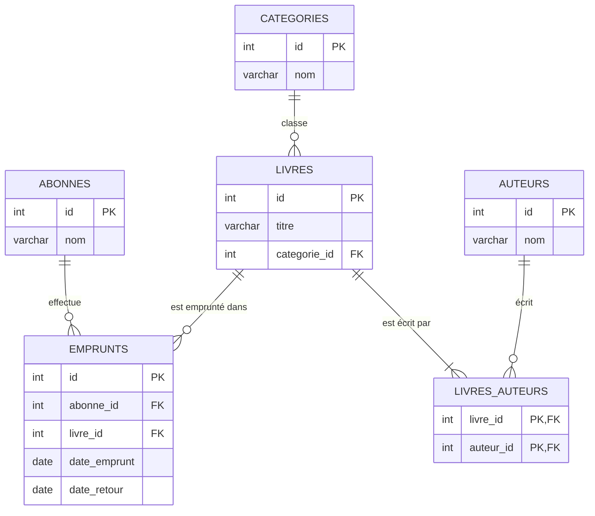
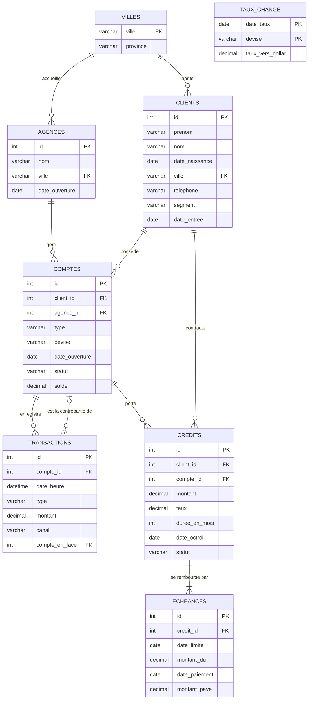

1. Lire un diagramme. Pour chacune de ces lignes, écris deux phrases (une dans chaque sens) et les cardinalités minimum et maximum :

CLASSES ||--|{ ELEVES : "accueille"
Une classe accueille un ou plusieurs eleves
Un eleve est accueillie dans une et une seule classe

PROFESSEURS ||--o{ COURS : "donne"
Un professeur donne zero ou plusieurs cours
Un cours est donné par un et un seul professeur

CLASSES }o--o{ COURS : "suit"
Une classe suit zero ou plusieurs cours
Un cours est suivi par zero ou plusieurs classe

PARENTS |o--o{ ELEVES : "a"
Un parent a zero ou plusieurs eleves
Un eleve a zero ou un parent

2. Dessiner à partir de règles. Une bibliothèque a ces règles : 
un abonné emprunte zéro ou plusieurs livres ; 
chaque emprunt concerne un seul abonné et un seul livre ; 
un livre peut être emprunté plusieurs fois (à des dates différentes) ; 
un livre appartient à une seule catégorie, et une catégorie contient plusieurs livres ; 
un livre peut avoir plusieurs auteurs, et un auteur plusieurs livres. 
Dessine le diagramme (relations avec verbes, cardinalités, tables d’association, clés primaires et étrangères).

3. Du diagramme à SQL. 
Pour le diagramme de l’exercice 2, 
écris les CREATE TABLE de livres, auteurs et de la table d’association entre les deux (clés primaire composée, clés étrangères, NOT NULL).
CREATE TABLE categories (
    id INT PRIMARY KEY AUTO_INCREMENT,
    nom VARCHAR(50) NOT NULL
);
CREATE TABLE auteurs (
    id INT PRIMARY KEY AUTO_INCREMENT,
    nom VARCHAR(100) NOT NULL
);
CREATE TABLE livres (
    id INT PRIMARY KEY AUTO_INCREMENT,
    titre VARCHAR(150) NOT NULL,
    categorie_id INT NOT NULL,
    CONSTRAINT fk_livres_categories FOREIGN KEY (categorie_id) REFERENCES categories(id)
);
CREATE TABLE livres_auteurs (
    livre_id INT NOT NULL,
    auteur_id INT NOT NULL,
    PRIMARY KEY (livre_id, auteur_id),
    CONSTRAINT fk_la_livres FOREIGN KEY (livre_id) REFERENCES livres(id),
    CONSTRAINT fk_la_auteurs FOREIGN KEY (auteur_id) REFERENCES auteurs(id)
);

4. Banque Horizon. 
Dessine le diagramme du projet bancaire, d’après ces règles : 
un client possède zéro ou plusieurs comptes, et un compte appartient à exactement un client (pas de compte joint) ; 
un compte est géré par exactement une agence, qui en gère plusieurs ; 
un compte a zéro ou plusieurs transactions ; 
un virement relie deux comptes (le compte en face est facultatif, car un dépôt n’en a pas) ; 
un client peut avoir zéro ou plusieurs crédits ; 
un crédit est adossé à un compte ; un crédit a plusieurs échéances ; une agence se trouve dans une ville. 
Ajoute pour chaque entité ses attributs (voir BRIEF_Projet_SQL_Banque.md), avec PK et FK.

-- 5. Vérifier avec des données. Dans congo_shop, écris quatre requêtes qui contrôlent ces cardinalités : 
-- (a) les commandes sans ligne, 
SELECT c.id, l.id as id_ligne FROM commandes c LEFT JOIN 
lignes_commande l ON c.id=l.commande_id WHERE l.id is NULL;
-- (b) les commandes qui ont plus d’une livraison, 
SELECT commande_id, COUNT(*) AS nb_livraisons
FROM livraisons
GROUP BY commande_id
HAVING COUNT(*) > 1;
-- (c) les produits sans catégorie, 
SELECT id, nom, categorie_id FROM produits WHERE categorie_id is NULL;
-- (d) les clients sans commande. 
SELECT c.id, c.prenom
FROM clients c
LEFT JOIN commandes o ON o.client_id = c.id
WHERE o.id IS NULL;
-- Écris d’abord, en commentaire, le résultat que ton diagramme t’annonce pour chacune, puis compare avec ce que la requête renvoie.

6. Réflexion (avec tes mots) : 
(a) pourquoi une clé étrangère seule ne peut-elle pas garantir « une commande a au moins une ligne » ? 
Parce qu'elle peut facultative
Comment la garantir ? 
il faut la rendre obligatoire
(b) Dans le projet bancaire, un virement concerne deux comptes : une seule relation suffit-elle, 
Une seule ne suffisent pas, il en faut 2
et pourquoi ? 
Parce qu'il faut un autre attribut pour le 2e compte
(c) À quoi sert d’afficher les clés primaires et étrangères dans un diagramme que tu publies ?
A savoir determiner les liaisons et les cardinalitées

